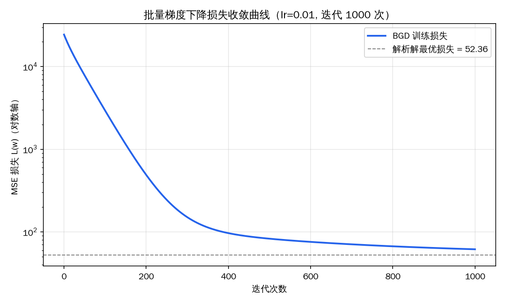
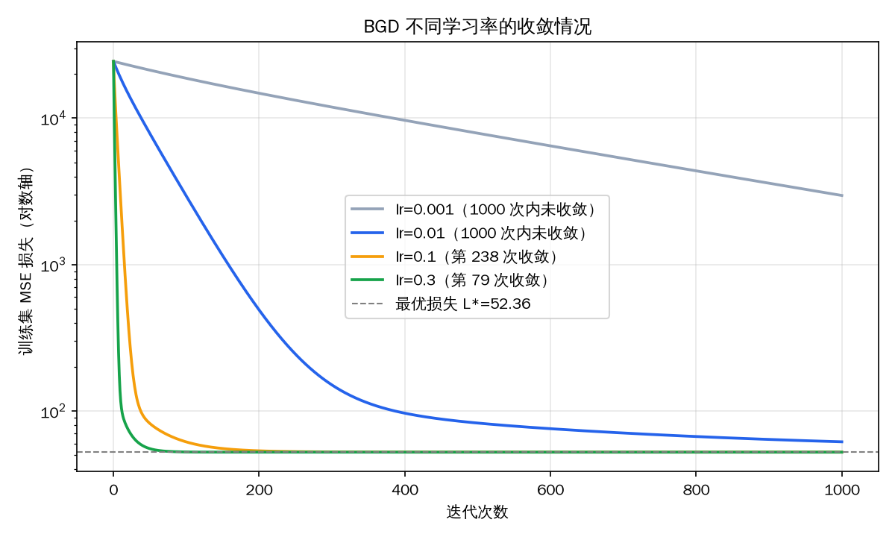
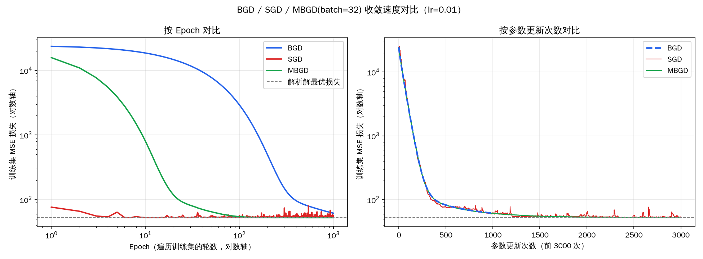
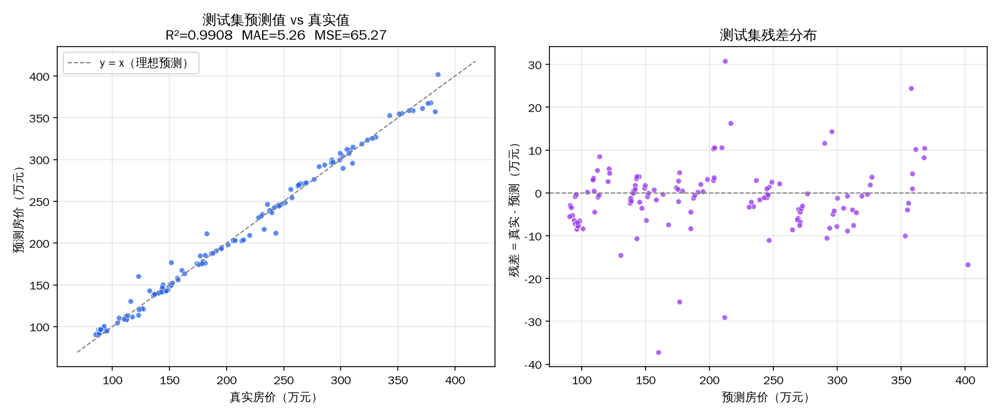
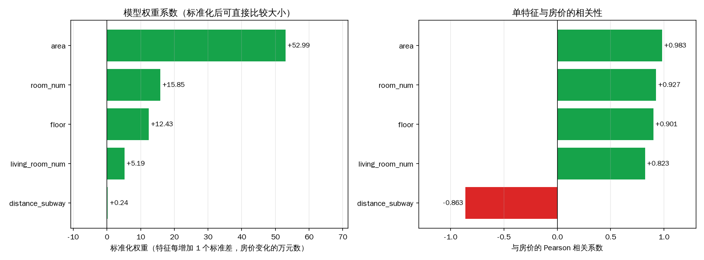
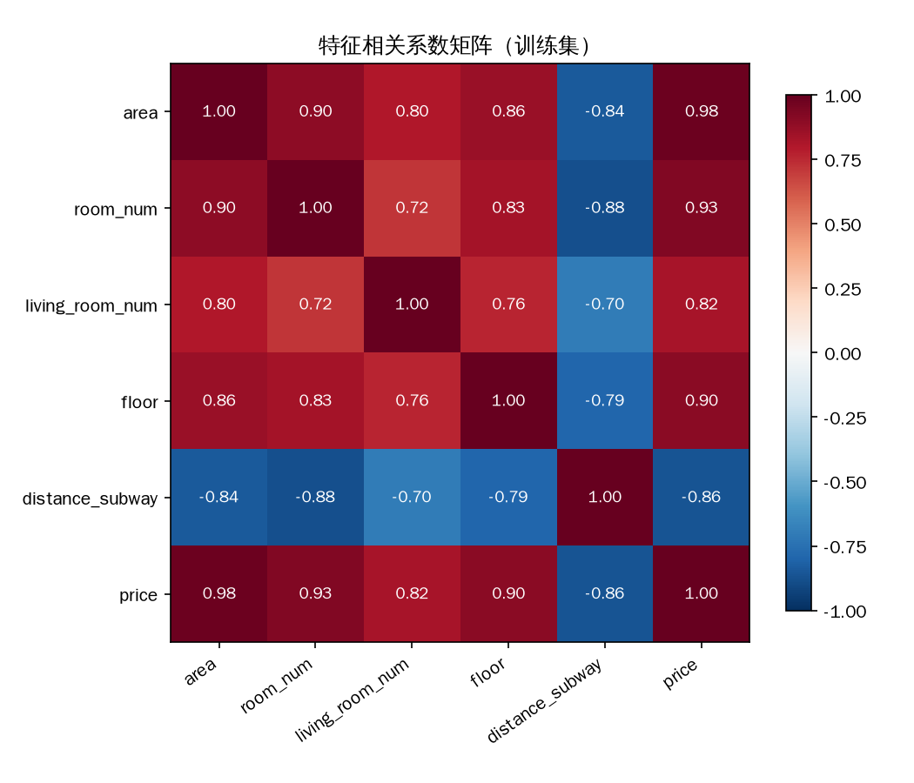

# 项目一：城市二手房房价预测系统 —— 实验报告

## 0. 项目结构与运行方式

```
fangjia/
├── 城市二手房房价预测（1000 条完整数据）(1).txt   原始数据
├── house_price.py      主程序：预处理 → 训练（BGD/SGD/MBGD）→ 评估 → 特征分析 → 出图
├── predict.py          预测脚本（读取训练好的模型）
├── requirements.txt
├── 项目报告.md          本报告
└── output/             运行后生成：6 张图、model.json、results.json、run_log.txt
```

```bash
pip install -r requirements.txt
python house_price.py                     # 训练并生成全部结果
python predict.py --area 89 --room 2 --living 1 --floor 15 --subway 0.8
```

线性回归、MSE 损失、梯度计算和三种梯度下降都用 numpy 手写，**没有调用 sklearn**。pandas 只用于读取数据，matplotlib 只用于画图。随机种子固定为 42，结果可以复现。

---

## 1. 数据预处理

**数据情况**：文件名写的是 1000 条，但实际只有 **653 条**样本（6 个字段）。部分行末尾带有 `# 异常值`、`# 缺失值` 注释，读取时用 `comment="#"` 去掉。

| 步骤 | 做法 | 结果 |
|---|---|---|
| 缺失值模拟 | 原数据只有 5 个缺失单元格（0.15%）。按题目要求，在 5 个特征列中再随机置空 60 个，使特征缺失率达到 **2%** | 各列缺失数：area 16、room_num 14、living_room_num 19、floor 11、distance_subway 5 |
| 异常值处理 | 删除面积 > 200㎡ 的样本 | 删除 3 条（205.3、208.7、210.5㎡），剩 650 条 |
| 数据集划分 | 随机打乱后按 80% / 20% 划分 | 训练集 520 条，测试集 130 条 |
| 缺失值填充 | 连续型（area、distance_subway）用**中位数**，离散型（room_num、living_room_num、floor）用**众数** | 统计量**只在训练集上计算**，再用于测试集，避免数据泄漏 |
| 离散特征编码 | 离散特征本身就是有序数值，按题目说明不做编码 | — |
| 特征标准化 | 5 个特征都做 Z-score：$x' = (x-\mu)/\sigma$ | μ、σ 同样只用训练集计算 |

> 说明：数据中有两条带“异常值（面积>200）”注释的样本，实际面积是 192.4 和 198.7㎡，不满足 >200 的规则，所以保留。它们的单价和其他样本一致，不属于真正的异常点。

---

## 2. 模型构建

**假设函数**（$w_0$ 为偏置项）：

$$\hat y = w_0 + w_1\cdot area + w_2\cdot room\_num + w_3\cdot living\_room\_num + w_4\cdot floor + w_5\cdot distance\_subway$$

在特征矩阵前加一列全 1，记为 $X\in\mathbb{R}^{m\times 6}$，模型写成矩阵形式 $\hat y = Xw$。

**损失函数**（MSE）：

$$L(w)=\frac{1}{2m}\sum_{i=1}^{m}(y_i-\hat y_i)^2=\frac{1}{2m}\lVert Xw-y\rVert^2$$

---

## 3. 优化算法

### 3.1 梯度推导

对任意参数 $w_j$ 求偏导（令 $x_{i0}=1$）：

$$\frac{\partial L}{\partial w_j}=\frac{1}{2m}\sum_{i=1}^{m}2(\hat y_i-y_i)\cdot\frac{\partial \hat y_i}{\partial w_j}=\frac{1}{m}\sum_{i=1}^{m}(\hat y_i-y_i)\,x_{ij}$$

逐个写出：

- $\dfrac{\partial L}{\partial w_0}=\dfrac1m\sum(\hat y_i-y_i)$
- $\dfrac{\partial L}{\partial w_1}=\dfrac1m\sum(\hat y_i-y_i)\cdot area_i$
- $\dfrac{\partial L}{\partial w_2}=\dfrac1m\sum(\hat y_i-y_i)\cdot room\_num_i$
- $\dfrac{\partial L}{\partial w_3}=\dfrac1m\sum(\hat y_i-y_i)\cdot living\_room\_num_i$
- $\dfrac{\partial L}{\partial w_4}=\dfrac1m\sum(\hat y_i-y_i)\cdot floor_i$
- $\dfrac{\partial L}{\partial w_5}=\dfrac1m\sum(\hat y_i-y_i)\cdot distance\_subway_i$

向量形式：$\nabla L=\dfrac1m X^\top(Xw-y)$，更新规则为 $w\leftarrow w-\alpha\nabla L$。

三种方法只是每次计算梯度所用的样本数不同，代码里共用同一个函数 `gradient_descent(batch_size=...)`：

| 方法 | 每次更新用的样本数 | 每个 epoch 更新次数 |
|---|---|---|
| BGD 批量梯度下降 | 全部 520 个 | 1 |
| SGD 随机梯度下降 | 1 个 | 520 |
| MBGD 小批量梯度下降 | 32 个 | 17 |

为了验证手写梯度下降是否正确，另外用正规方程 $w=(X^\top X)^{-1}X^\top y$ 求出解析解作为参照，最优训练损失 $L^*=52.36$。

### 3.2 BGD（lr=0.01，迭代 1000 次）



损失从 24,000 左右降到 **61.6**，但**还没到最优值 52.36**，和解析解的权重最多差 11.7。

**原因：特征之间高度相关，导致损失曲面“又扁又长”。** 标准化后 Hessian 矩阵 $X^\top X/m$ 的特征值为 0.085 ~ 4.24，条件数约 50。梯度下降在最平坦方向上每一步只能缩小 $(1-\alpha\lambda_{min})$ 倍的误差，lr=0.01 时这个值是 0.99915，迭代 1000 次后还剩 **42.7%** 的误差。

**学习率实验**：BGD 稳定的学习率上界是 $2/\lambda_{max}=0.47$，所以可以放心把学习率调大。



| 学习率 | 1000 次后训练损失 | 降到 $L^*$×1.01 以内所需迭代次数 |
|---|---|---|
| 0.001 | 2964.6 | 未达到 |
| 0.01 | 61.60 | 未达到 |
| **0.1** | **52.36** | **238** |
| 0.3 | 52.36 | 79 |

**最终模型选用 BGD，lr=0.1，迭代 1000 次**。它和正规方程解析解的权重差距小于 0.004，说明手写的梯度下降完全正确。

### 3.3 BGD / SGD / MBGD 收敛速度对比（统一 lr=0.01）



| 方法 | 1000 epoch 后训练损失 | 达到 $L^*$×1.01 所需 epoch | 对应参数更新次数 | 耗时 |
|---|---|---|---|---|
| BGD | 61.60 | 未达到 | — | 0.01 s |
| SGD | 52.67（有波动） | **6** | 3,120 | 1.8 s |
| MBGD | 52.37 | 142 | 2,414 | 0.11 s |

结论：

1. **按 epoch（遍历一遍数据）计算：SGD 最快 > MBGD > BGD。** SGD 每遍历一次数据就更新 520 次参数，BGD 只更新 1 次。
2. **按参数更新次数计算，三条曲线几乎重合**（右图）。在本数据集上，单个样本的梯度方向已经足够准确，所以“更新得多”就是收敛快的主要原因。
3. **SGD 的缺点是在最优点附近来回抖动**，最终损失比 MBGD 高，而且逐样本循环的计算开销最大。若想消除抖动，需要让学习率逐渐衰减。
4. **MBGD 兼顾两者**：收敛快、曲线平稳，还能利用矩阵运算提高效率，是实际中最常用的选择。

---

## 4. 模型评估

测试集共 130 条，训练过程中没有用到。

| 模型 | 训练 R² | 测试 R² | 测试 MAE（万元） | 测试 MSE | 测试 RMSE |
|---|---|---|---|---|---|
| **BGD (lr=0.1，最终模型)** | 0.9849 | **0.9908** | **5.26** | **65.27** | 8.08 |
| BGD (lr=0.01) | 0.9822 | 0.9894 | 6.38 | 75.51 | 8.69 |
| SGD (lr=0.01) | 0.9848 | 0.9911 | 5.30 | 63.17 | 7.95 |
| MBGD (lr=0.01) | 0.9849 | 0.9908 | 5.25 | 65.14 | 8.07 |
| 正规方程（参照） | 0.9849 | 0.9908 | 5.26 | 65.27 | 8.08 |

> 注：表中 MSE 按常规定义 $\frac1m\sum(y-\hat y)^2$ 计算，没有除以 2；训练时的损失函数 $L(w)$ 多了一个 1/2，所以数值是这里的一半。



- 测试集 **R² = 0.991**，模型能解释 99% 的房价波动，平均绝对误差只有约 **5.3 万元**（房价均值约 205 万元，相对误差约 2.6%）。
- 散点紧贴 $y=x$ 对角线，残差围绕 0 随机分布，没有明显的曲线规律，说明线性模型适合这份数据。
- 测试集指标略好于训练集，主要是因为测试集只有 130 条、随机性较大，**不是过拟合**。
- 测试集中残差绝对值超过 15 万元的 7 个点里，有 5 个是被随机置空、再用中位数/众数填充的样本（例如面积缺失后被填成 89㎡）。也就是说，大误差主要来自缺失值填充，而不是模型本身。

---

## 5. 特征分析



| 特征 | 标准化权重 | 原始单位系数 | t 值 | 与房价相关系数 | VIF |
|---|---|---|---|---|---|
| area | **+52.99** | +2.019 万元/㎡ | 41.9 | +0.983 | 7.9 |
| room_num | +15.85 | +18.71 万元/间 | 13.0 | +0.927 | 7.3 |
| floor | +12.43 | +1.704 万元/层 | 13.0 | +0.901 | 4.5 |
| living_room_num | +5.19 | +11.37 万元/间 | 6.6 | +0.823 | 3.0 |
| distance_subway | +0.24 | +0.36 万元/km | **0.24（不显著）** | **−0.863** | 4.9 |

还原到原始单位的预测方程：

$$price = -62.80 + 2.019\cdot area + 18.71\cdot room\_num + 11.37\cdot living\_room\_num + 1.704\cdot floor + 0.36\cdot distance\_subway$$

**怎么看权重**：特征都标准化过，所以“标准化权重”表示该特征增加 1 个标准差时房价变化多少万元，可以直接比较大小。

**影响力排序：area > room_num > floor > living_room_num > distance_subway**

1. **面积（area）是决定性因素。** 面积每增加 1 个标准差（约 26㎡），房价上涨约 53 万元，换算后约 **2 万元/㎡**。它的权重是第二名的 3 倍以上，t 值高达 41.9。
2. **卧室数（room_num）和楼层（floor）的影响也很明显。** 在面积相同时，多一间卧室约贵 18.7 万元，楼层每高 1 层约贵 1.7 万元。两者都高度显著（t≈13）。
3. **客厅数（living_room_num）影响较小但仍然显著**，每多一间客厅约贵 11.4 万元。
4. **距地铁距离（distance_subway）单独看和房价强负相关（r = −0.86），完全符合“离地铁越远越便宜”的常识；但在多元模型里，它的权重接近 0 且不显著。**

**为什么 distance_subway 的权重不是负的？** 这是**多重共线性**造成的（见下方相关矩阵）。在这份数据里，distance_subway 和 area 的相关系数为 −0.84，和 room_num 为 −0.88：面积大、房间多的房子普遍离地铁更近。地铁距离对房价的影响，大部分已经通过面积体现出来；控制住面积、户型和楼层后，它几乎没有剩余的解释力。



补充两点：

- 用 lr=0.01 训练 1000 次、**还没收敛**的 BGD，distance_subway 的权重是 **−3.2**，正好符合题目预期的“为负”。这是因为没收敛时，梯度下降还没把相关特征之间的权重“分清楚”，起到了类似正则化的作用，权重会更接近单变量相关性。**所以用没收敛的模型解释特征是不可靠的**，本报告的分析以已收敛的模型为准。
- 所有特征的 VIF 都小于 10，共线性还没有严重到让模型失效（测试集 R² 依然达到 0.99），但它会让单个系数的解释变得不稳定。如果要更可靠地判断地铁距离的独立作用，需要更多样的数据（比如面积相同但离地铁远近不同的房子），或者使用岭回归等正则化方法。

---

## 6. 总结

1. 完成了数据清洗（模拟 2% 缺失、按中位数/众数填充、删除 3 个面积 >200㎡ 的异常值、Z-score 标准化），并严格保证统计量只来自训练集。
2. 手写实现了多元线性回归、MSE 损失、梯度推导，以及 BGD / SGD / MBGD 三种优化方法，结果和正规方程解析解一致。
3. 由于特征高度相关（条件数约 50），lr=0.01 时 BGD 迭代 1000 次无法收敛；把学习率调到 0.1 后 238 次就收敛了。按 epoch 计算 SGD 收敛最快，MBGD 最稳定。
4. 最终模型在测试集上 **R² = 0.991、MAE = 5.26 万元、MSE = 65.3**。
5. 面积是影响房价的最主要因素（约 2 万元/㎡），其次是卧室数和楼层。地铁距离单独看与房价强负相关，但它的影响基本被面积吸收，在多元模型中不显著。
